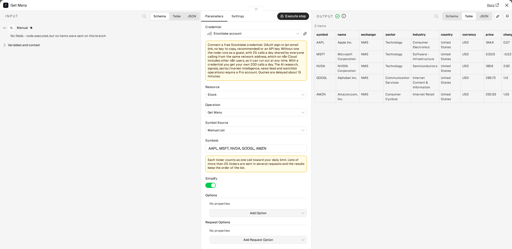
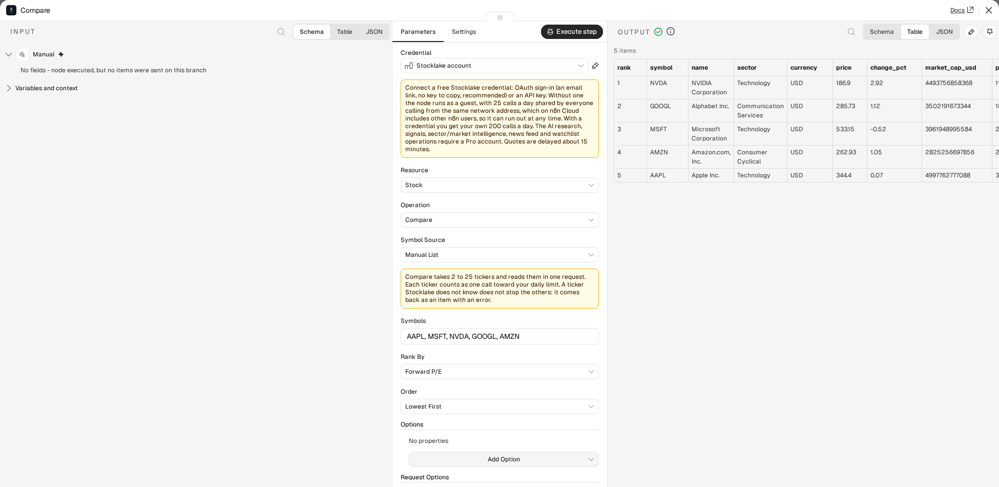
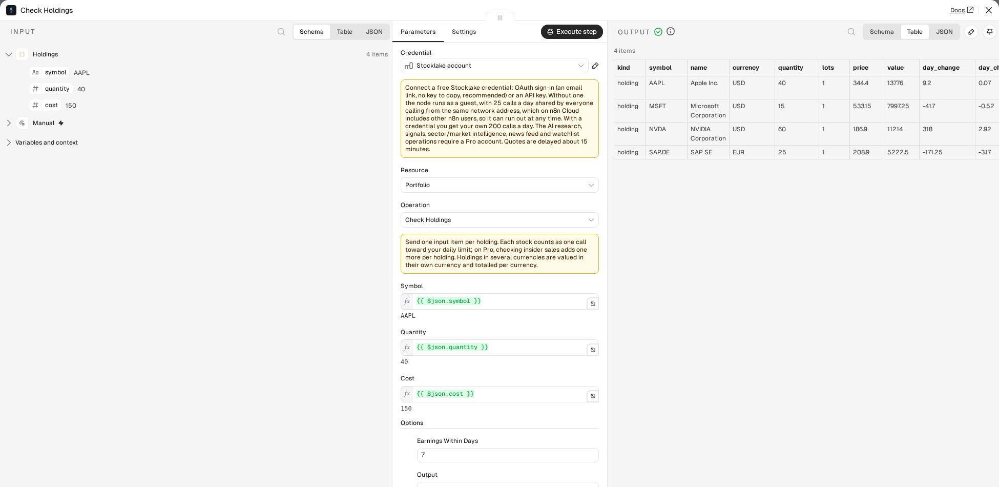
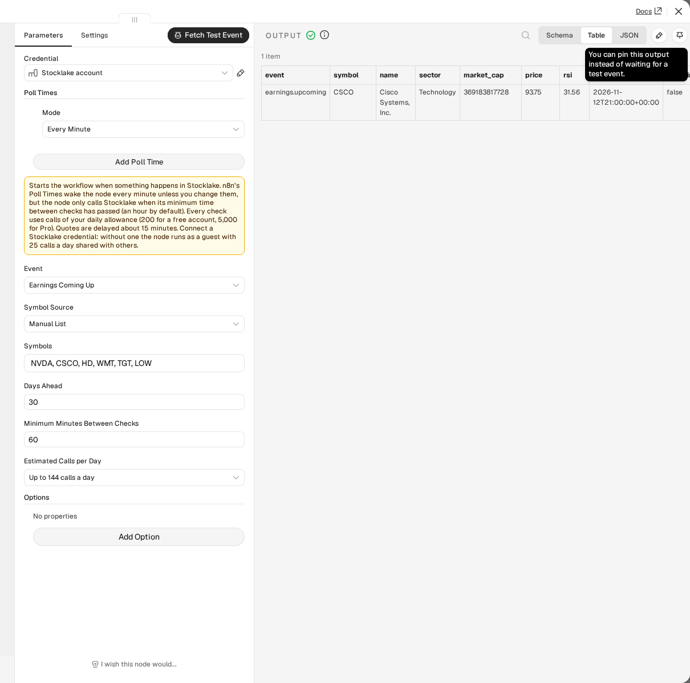
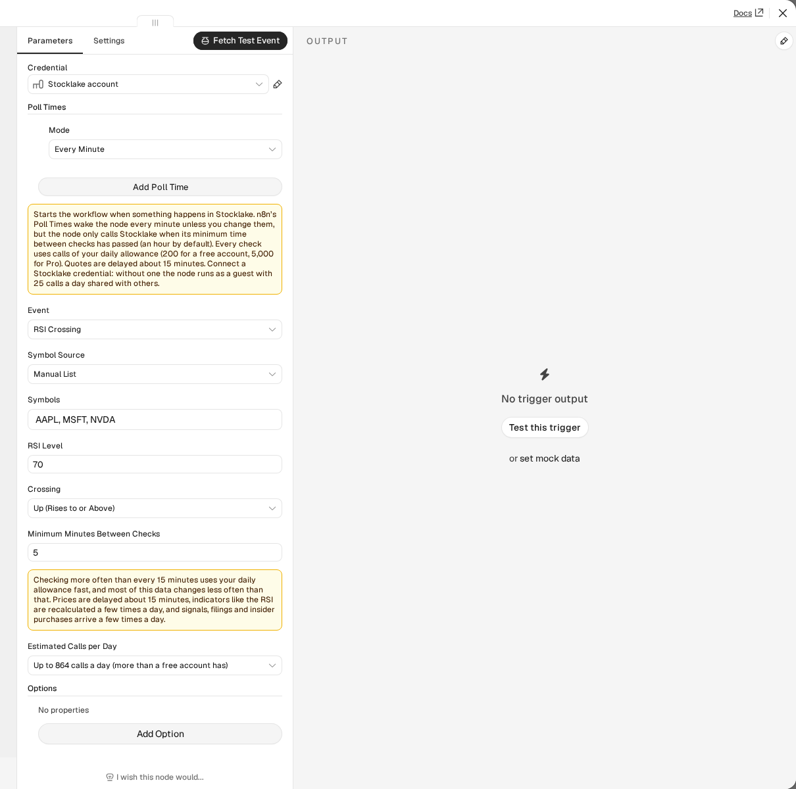
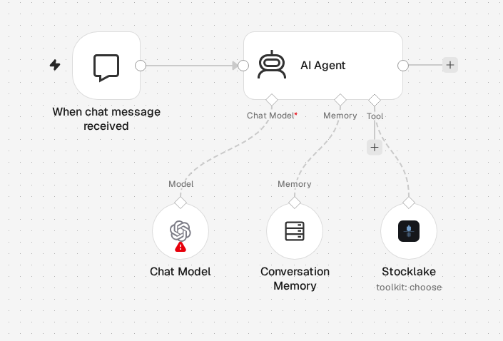
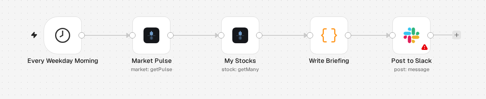
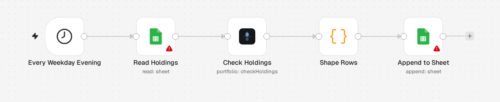

# n8n-nodes-stocklake

Stock market data in n8n, and a trigger that starts a workflow when something happens.

[Stocklake](https://stocklake.dev) covers 3,500+ stocks and ETFs in the US, Europe and Asia: prices (delayed about 15 minutes), fundamentals, technical indicators, insider trades, SEC filings, earnings, news and macro data, plus Pro research and trade signals. This package adds two nodes to n8n:

- **Stocklake** — 25 operations in 9 resources. Lists come back as one item per row, so they go straight into Filter, Sort, Split In Batches or a spreadsheet. Three operations (Compare, Snapshot, Check Holdings) combine several calls and shape the result inside n8n. It also works as a tool for an AI agent.
- **Stocklake Trigger** — a polling trigger with six events (a new signal, earnings coming up, a new SEC filing, an insider purchase, an RSI crossing, a price move). Each event fires once.



Stocklake has a free tier and a no-key guest mode. The free operations work without signing up, but on n8n Cloud you should connect a free credential (see [Credentials](#credentials)). AI research, signals, sector and market intelligence, the news feed and the watchlist need a Pro account.

**Contents:** [Installation](#installation) · [Credentials](#credentials) · [Operations](#resources-and-operations) · [Output](#output-version-2) · [Combined operations](#combined-operations-version-2) · [Stocklake Trigger](#stocklake-trigger) · [AI agents](#using-stocklake-with-an-ai-agent-version-2) · [Templates](#workflow-templates) · [Limits and errors](#limits-and-errors-version-2) · [Upgrading from 0.1.x](#node-versions)

## Installation

Follow n8n's guide to [install a community node](https://docs.n8n.io/integrations/community-nodes/installation/) in your n8n instance and enter:

```
n8n-nodes-stocklake
```

## Credentials

**On n8n Cloud, connect a credential.** Without one, the node runs as a guest, and guest calls are limited to 25 a day per network address. n8n Cloud sends many customers' requests from shared addresses, so that allowance is shared with other n8n users and can already be used up when you start. A free Stocklake account (OAuth2: sign in with an email link, nothing to copy) gives you your own 200 calls a day. If the guest limit is hit, the node's error says so and what to do. On a self-hosted n8n the guest limit is yours alone.

Credentials are otherwise **optional**. Without one, the node calls Stocklake as an unauthenticated guest (25 calls a day, free operations only). Once connected, either way below, it's 200 calls a day; a Pro account unlocks 5,000 calls a day plus the AI research operations. Current limits are on [stocklake.dev/docs#rate-limits](https://stocklake.dev/docs#rate-limits). The node's **Authentication** dropdown picks between the two:

**OAuth2 (recommended)**: add a **Stocklake OAuth2 API** credential and click Connect. No key to copy or paste: your browser opens, you sign in with a magic link (or you're already signed in), and n8n handles the rest, including token refresh. Under the hood this uses n8n's Dynamic Client Registration support against Stocklake's own OAuth server, the same mechanism Claude and ChatGPT connectors use.

**API key**: go to [stocklake.dev/login](https://stocklake.dev/login), enter your email, click the magic link, and your key is on the account page. Add a **Stocklake API** credential in n8n and paste it in. Useful if your n8n instance can't complete a browser-based OAuth flow (some headless or CI setups).

### Plans and limits

| Plan | Calls a day | Operations |
|---|---|---|
| Guest (no credential) | 25 per network address | Free operations: Stock: Get / Get Many / Compare / Snapshot / Get History / Get News / Get Insider Activity / Get Financials / Get Filings / Get Activity · Portfolio: Check Holdings · Market: Get Movers / Get Pulse / Get Economic Calendar · Earnings: Get Calendar · Screener: Screen Stocks |
| Free | 200 | Same operations as guest |
| Pro | 5,000 | All of the above (with more on some: the AI read on Get Insider Activity, five years and quarterly statements on Get Financials, summaries on Get Filings, the content of each Get Activity item, a longer Get Economic Calendar window), plus: Stock: Get Research / Get Indicator History / Get Analyst Trend · Market: Get Assessment · Sector: Get Intelligence · Earnings: Get Intelligence · News: Get Feed · Signal: Get Many · Watchlist: Get |

A Pro-only operation called without a Pro key returns a clear error explaining what's needed. The node doesn't hide these operations: Stocklake's philosophy is "data is free, intelligence is Pro", and it's useful to see what's available before upgrading.

Calls are counted as the API bills them: list operations (Get Many, Screen Stocks, Get Movers, Signals, Earnings Intelligence and the like) count **one call per row returned**, not one per request.

## Resources and operations

Stocklake offers 22 tools: 13 available without Pro and 9 that need it. Version 2 of the node exposes all 25 (16 free, 9 Pro) operations in 9 resources: the 22 tools and three operations that combine several calls (Compare, Snapshot, Check Holdings). Each operation links to its reference page:

- **Stock** ([reference](https://stocklake.dev/docs/tools#get_stock)): Get, Get Many (batch, up to 25 symbols), Get History, Get News, Get Research, Get Indicator History, Get Insider Activity, Get Financials ([reference](https://stocklake.dev/docs/tools#get_stock_financials); balance sheet, income statement and cash flow, latest year free, 5 years and quarterly on Pro), Get Filings ([reference](https://stocklake.dev/docs/tools#get_stock_filings); SEC 8-K filings, summaries on Pro), Get Activity ([reference](https://stocklake.dev/docs/tools#get_stock_activity); one timeline of news, filings, insider trades, earnings, analyst changes and setups), Get Analyst Trend ([reference](https://stocklake.dev/docs/tools#get_analyst_trend); Pro), plus Compare and Snapshot (see [Combined operations](#combined-operations-version-2))
- **Portfolio** (built on [get_stocks](https://stocklake.dev/docs/tools#get_stocks)): Check Holdings
- **Screener** ([reference](https://stocklake.dev/docs/tools#get_screener)): Screen Stocks (filter and rank the universe by sector, RSI, market cap, analyst rating, AI score and more)
- **Market** ([reference](https://stocklake.dev/docs/tools#get_market_pulse)): Get Pulse (VIX, Fear & Greed, breadth), Get Movers, Get Assessment (AI macro regime), Get Economic Calendar ([reference](https://stocklake.dev/docs/tools#get_economic_calendar); rate decisions, CPI, GDP, payrolls)
- **Sector** ([reference](https://stocklake.dev/docs/tools#get_sector_intelligence)): Get Intelligence (one sector, or all 11 as a rotation view)
- **Earnings** ([reference](https://stocklake.dev/docs/tools#get_earnings_calendar)): Get Calendar, Get Intelligence (AI-scored upcoming earnings)
- **News** ([reference](https://stocklake.dev/docs/tools#get_news_feed)): Get Feed (market-wide AI-flagged news briefing)
- **Signal** ([reference](https://stocklake.dev/docs/tools#get_signals)): Get Many (the AI-screened trade-idea queue)
- **Watchlist** ([reference](https://stocklake.dev/docs/tools#get_watchlist)): Get (your starred symbols on stocklake.dev, with the latest data)

The **Symbol** field on single-stock operations is a Resource Locator: search by company name or ticker ("From List", backed by Stocklake's public autocomplete, no key needed), or type a ticker directly ("By Ticker"). With nothing typed, the list also shows your watchlist.

## Node versions

The node has two versions. **Version 2** is the default for new nodes. **Version 1** is the node as published in 0.1.x: workflows saved with it keep running with the same parameters and the same output, and are never converted automatically. To move a node to version 2, open its settings and pick the new version. See the [changelog](./CHANGELOG.md) for what 2.0.0 changes.

## Output (version 2)

Version 2 behaves like a native n8n node. Operations that return a list give **one item per row**, so you can wire them straight into Filter, Sort, Split In Batches or a spreadsheet node without splitting a blob first:

- Stock: Get Many, Get History, Get Indicator History, Get News, Get Filings, Get Activity, Get Analyst Trend
- Screener: Screen Stocks
- Market: Get Movers (one item per mover, with a `category` field), Get Economic Calendar (rows carry a `bucket` of `released_recent` or `upcoming`)
- Earnings: Get Calendar, Get Intelligence
- News: Get Feed
- Signal: Get Many
- Watchlist: Get

Every other operation (Stock: Get, Get Research, Get Financials, Get Insider Activity; Market: Get Pulse, Get Assessment; Sector: Get Intelligence) returns the whole response as one item.

- **Simplify** (on by default) returns a flat, chosen set of fields per row. Turn it off for every field the API returns, including nested objects. Rows that lack a chosen field simply leave it out.
- **Return All / Limit.** With Return All off, **Limit** is the number of rows you get back. With it on, you get everything the API will give you: Activity reads page after page, the Earnings Calendar pages through the whole window on Pro, Get Many sends symbols in batches of 25, and the other operations ask for the API's maximum per call (Screener 25, Signals 50, News Feed 25, Earnings Intelligence 25, Filings 25, Movers 20 per category). A Limit above an operation's per-call maximum is held to that maximum; Activity and the Earnings Calendar read further pages to reach it. Each page or batch counts as a call on your daily limit, as the API bills it.
- **Include Response Metadata** (under Options) adds what the API returns around the rows, such as counts, applied filters and notes about the plan, to every item as `_meta`. If a list comes back empty, that one item is still returned so the note is not lost.
- Rows from History, Indicator History, News and Analyst Trend carry the `symbol` they belong to, so rows from several input items stay distinguishable after a Merge.
- Every output item is paired with the input item that produced it, so expressions such as `$('Stocklake').item` work.

Version 1 keeps returning the whole response as one item; its output has not changed.

## Combined operations (version 2)

Three operations combine several calls and shape the result inside n8n, which the generic MCP Client node cannot do. All three are free; a Pro account adds columns or flags. Each has a ready-to-run workflow in [`examples/`](./examples) (paste the file onto an empty canvas).



**Stock → Compare** ([example](./examples/compare-stocks.workflow.json)) puts 2 to 25 stocks side by side in one request. You get one item per stock with the same columns on every item: `price`, `change_pct`, `market_cap_usd`, `pe_forward`, `pe_trailing`, `rsi`, `week52_low`, `week52_high`, `week52_position_pct` (0 at the 52-week low, 100 at the high), `analyst_rating`, `analyst_target`, `analyst_upside_pct`, and on Pro `rating_score`, `rating_direction`, `ai_verdict`, `ai_score`. A value Stocklake does not have is `null`, not a missing key. **Rank By** sorts the items by a column and adds `rank` (1 is first; equal values share a rank; stocks without a value come last with `rank: null`); **Order** says which end comes first. The tickers come from the Symbols field, or with **Symbol Source: From Input Items** from all input items together.

**Stock → Snapshot** ([example](./examples/stock-snapshot.workflow.json)) reads one stock into one flat item for people and AI agents: the quote, `rsi` and `rsi_state`, `macd_state`, `price_vs_sma50` and `price_vs_sma200`, the 52-week position, the analyst view, `next_earnings_date` and `next_earnings_in_days`, the latest filing's date, title, headline and link, on Pro the rating and the AI verdict, and a `summary` sentence with the same facts. It makes two requests; if the filing request fails you still get the snapshot, with a `notes` entry saying so.



**Portfolio → Check Holdings** ([example](./examples/check-holdings.workflow.json)) takes one input item per holding. **Symbol**, **Quantity** and **Cost** are expressions (`{{ $json.symbol }}`, `{{ $json.quantity }}`, `{{ $json.cost }}` by default); Cost is optional and is the price per share unless **Options → Cost Is** says it is the total. Items with the same ticker are added up as lots of one holding, with the weighted average cost. Each holding comes back as an item with `value`, `day_change`, `day_change_pct`, `cost`, `pl`, `pl_pct`, `weight_pct`, `rsi`, `earnings_date`, `earnings_in_days` and `flags`:

- `rsi_overbought` / `rsi_oversold`: RSI at or above 70 / at or below 30 (change the limits in Options).
- `earnings_soon`: earnings within 7 days (Options: up to 30). The dates come from the earnings calendar; a stock the calendar does not list uses its own earnings date.
- `large_insider_sale` (Pro): insiders sold $1,000,000 or more in the last 30 days (Options: the amount, or switch the check off). It costs one call per holding; on a free account it is skipped and the output says so.

One more item, `kind: "summary"`, follows the holdings: `total_value`, `day_change`, `day_change_pct`, `total_cost`, `total_pl`, `top_weight_symbol`, `top_weight_pct`, `flagged_holdings`, and which holdings carry which flag. Holdings in several currencies are valued in their own currency and totalled per currency in `by_currency` (there is no single total or weight without exchange rates). **Options → Output** returns the holdings only or the summary only.

Quotes are read 25 holdings per request, as in Get Many. **One bad symbol does not sink the batch**: in all three operations a ticker Stocklake does not know, a value that cannot be a ticker, a quantity that is not a number, and a request that fails because of one symbol each come back as their own item (`found: false` or `valid: false`, with an `error`), paired with the input item they came from, and everything else is still returned. A failure that would hit every symbol alike (a rejected key, a used-up daily limit) stops the run with the usual error. The summary counts the holdings it could not value in `failed`.

## Stocklake Trigger

A second node, **Stocklake Trigger**, starts a workflow when something happens. It checks Stocklake on a schedule (a polling trigger) and returns only what is new, once. The generic MCP Client node cannot start a workflow; this one can.



| Event | Fires when | Reads | Plan |
|---|---|---|---|
| **New Signal** | Stocklake flags a signal, optionally only for one direction, above a score, or for chosen stocks | `get_signals` | Pro |
| **Earnings Coming Up** | one of your stocks reports within N days (1-30). Once for each report date; a date that moves fires again | `get_earnings_calendar` | Free |
| **New SEC Filing** | a new 8-K for one of your stocks, with title, headline and link (summaries on Pro) | `get_stock_filings` | Free |
| **Insider Purchase** | an insider buys shares worth at least an amount (shares times price) | `get_insider_activity` | Free |
| **RSI Crossing** | a stock's RSI goes from one side of a level to the other, up, down or either way | `get_stocks` | Free |
| **Price Move** | a stock is up or down by more than a percentage on the day, once per stock, day and direction | `get_stocks` | Free |

Every item has an `event` field (`signal.new`, `earnings.upcoming`, `filing.new`, `insider.purchase`, `rsi.crossed`, `price.moved`) next to the data of the event. An RSI item carries `rsi`, `previous_rsi`, `threshold` and `direction`; a price item `change_pct`, `prev_close`, `direction` and `threshold_pct`; an earnings item `days_until`.

**Symbols.** Signals look at every stock unless you give a list; the other events take a **Manual List** or **My Watchlist** (Pro). Filings and insider purchases are read one request per stock, so they take at most 25 stocks; the others up to 100.

**Fires once.** The node remembers what it has sent in the workflow's static data (the ids of the events, at most 500 to 2,000 depending on the list with the oldest dropped first, or the last RSI value per stock). The first check after you activate the workflow, or after you change the settings that decide what is asked for, only records the situation and starts nothing: a stock that is already above the RSI level, or a filing that is already there, is not news. Turn on **Options → Fire on Existing Items** to have that first check send what exists. A stock you add to the list later is recorded first and announced from its next event. n8n saves the static data when the node fires and when the workflow is activated, so after a restart the node may announce an RSI crossing again.

**Crossing, not "is above".** An RSI of exactly the level counts as above. The node compares each stock with its value at the previous check, so a stock that stays above 70 fires once, when it gets there, not at every check. Checks run on the schedule, so a crossing that reverses between two checks is not seen. The RSI is recalculated a few times a day: checking more often finds nothing new.

**Test mode.** **Fetch Test Event** returns the latest event that matches right now (the newest signal or filing, the next report, the biggest move, a stock on the chosen side of the RSI level) without touching the saved state, so you can build the rest of the workflow. If nothing matches, the error says what to change to get a sample.

**Calls and schedule.** Every check uses calls of your daily allowance: a list tool counts one call per row it returns and every stock of a check counts at least one. n8n's **Poll Times** start at every minute, so the node has its own **Minimum Minutes Between Checks**, 60 by default: it only calls Stocklake when that much time has passed since its last check, whatever the Poll Times are. Set both to check more often. **Estimated Calls per Day** shows the upper bound for the event, the stocks and the interval (a watchlist is one call per stock on it per check, and is read at most once an hour). Under 15 minutes the node warns. A check that fails (a Pro event with a free key, a used-up allowance) waits for the interval and shows the error in the execution.



[`examples/earnings-and-rsi-alerts.workflow.json`](./examples/earnings-and-rsi-alerts.workflow.json) has two triggers (earnings in the next week, RSI above 70) that format a message for Slack or email.

## Using Stocklake with an AI agent (version 2)

The node is usable as a tool: add it to an AI Agent's tool input (it shows up as **Stocklake Tool**). Version 2 tunes it for models:

- **A description written for a model, per operation.** Set Resource and Operation as usual and the tool's **Description** is filled in: what comes back, when to use it, what a free key gets. Edit it if you want to add your own guidance.
- **`$fromAI()` defaults.** The fields an agent should fill in (ticker, days, limit, and for some operations a preset, sector, category or ranking) default to a `$fromAI()` expression, so nothing has to be wired by hand. Days and limit have a default, so the agent may leave them out; the ticker is required. Return All, Symbol Source and paging are hidden for a tool.
- **Toolkit: one tool, an operation filter.** Set **Resource** to **Toolkit (Agent Chooses the Operation)** and the agent gets one tool that offers several operations and picks one from the question. **Operations the Agent May Use** is the filter: the agent is told about those operations only (the description follows the filter) and cannot run any other, so a read-only market-data agent never sees the operations you leave out. A new Toolkit starts with the operations that work without Pro; Pro operations can be added and fail for a free key. The call is checked before anything is sent, and an agent that names an unknown or switched-off operation, or leaves out a required argument, gets an error that says what is allowed. Everything else works as in the operation itself (batching, one bad ticker does not stop the rest, the credential and Request Options). Check Holdings is not in the Toolkit.



A ready workflow is the [AI agent template](./templates/ai-agent-with-stocklake-tools.json). The agent needs a chat model that supports tool calling. Toolkit descriptions are n8n expressions, so they need a current n8n.

## Workflow templates

Five workflows in [`templates/`](./templates), written for n8n's template library. Paste a file onto an empty canvas (Ctrl+V). All five work with a free Stocklake account.

| Template | What it does |
|---|---|
| [Daily stock briefing to Slack](./templates/daily-watchlist-briefing-slack.json) | Every weekday morning: the market pulse (VIX, Fear & Greed, S&P 500) and your stocks in one Slack message |
| [Earnings week alert by Gmail](./templates/earnings-week-alert-gmail.json) | The **Earnings Coming Up** trigger: an email once for each of your stocks that reports within 7 days |
| [Oversold and overbought digest by email](./templates/oversold-screener-digest-email.json) | The ten most oversold and the ten most overbought stocks, by email, each weekday evening |
| [Holdings check logged in Google Sheets](./templates/holdings-check-google-sheets.json) | Reads your holdings from a sheet, values them with **Check Holdings** and appends one row per holding |
| [AI agent with Stocklake tools](./templates/ai-agent-with-stocklake-tools.json) | A chat agent that answers market questions with numbers from a filtered Stocklake toolkit |





More small workflows are in [`examples/`](./examples) (Compare, Snapshot, Check Holdings, an oversold digest, the toolkit agent, the trigger) and [`demo-workflows/`](./demo-workflows).

## Symbols from earlier steps (version 2)

Get Many and the Earnings Calendar have a **Symbol Source**:

- **Manual List** (Get Many's default): tickers typed in the Symbols field, separated by commas.
- **From Input Items**: set **Symbol** to an expression such as `{{ $json.ticker }}`. The node reads it for every input item, works on all of them together in one run, and pairs each output row with the input item that supplied its ticker. A value can also be a comma-separated list.
- **From My Watchlist** (Pro): the symbols starred in your Stocklake account.
- **All Companies** (Earnings Calendar's default): no symbol filter.

Whatever the source, the list is cleaned before anything is sent: trimmed, upper-cased and de-duplicated, with the first occurrence keeping its place. A value that cannot be a ticker does not fail the run. It comes out as its own item (`valid: false` with an `error`), paired with the input item it came from, and the other tickers still run. Lists of more than 25 tickers are sent in batches of 25 and the rows come back in the order of the list (the Earnings Calendar keeps its date order).

Each ticker counts as one call toward your daily limit. When a run needs more than 25 calls, the node says so in the output panel before it starts, for example "About 60 calls against your daily allowance". With **Include Response Metadata** on, `_meta` also carries `estimated_calls`, `requests`, `invalid_symbols` and `duplicates_removed`.

## Dropdowns that come from Stocklake (version 2)

Some fields that were typed or fixed lists in version 1 are filled from Stocklake when you open them, so they follow the API instead of drifting from it: **Sector** (Screener, Earnings, Sector), **Preset** (Screener; High Conviction is marked "(Pro)"), **Source** and **Direction** (Signal), **Types** (Stock → Get Activity), and the symbol picker, whose list also shows **your watchlist** (marked ★) when you open it with nothing typed.

- Loading these does not use up your daily calls. The values are read from the error the API gives for a value it does not accept, and a rejected call is not counted. Each list is remembered for 30 minutes per credential, so opening the editor again does not call the API again.
- A Pro-only call is never made for a credential that is not Pro. Signal Source and Direction, and the watchlist, are only loaded for a Pro credential; otherwise you see the lists that ship with the node (and, in the symbol picker, the search you had before).
- If a load fails (no network, a used-up daily limit, a guest whose calls are gone), the editor shows the lists that ship with the node. Nothing breaks, and the next open tries again after a minute.
- **Country** (Screener, under Additional Fields) is a fixed list of the countries that have stocks in the universe; the API has no list of them to load. For a country that is not in the list, use an expression with the full English name.
- Signal **Source** no longer offers "Social": the API has no such source and answers it with an error. Version 1 still lists it.

## CSV export (version 2)

**Options → Download as CSV** on the list operations (Get History, Get Indicator History, Screen Stocks, Compare, and the others that return rows) returns the rows as one binary CSV file (field `data`, change it with **Put CSV in Field**) instead of one item per row. The file has a header row, columns in the order they first appear, ISO dates as Stocklake sends them, a point as decimal separator, a UTF-8 byte order mark so Excel reads it correctly, and nested values as dotted columns (`indicators.rsi`). Text that a spreadsheet could run as a formula (starting with `=`, `+`, `-` or `@`, but not a number) gets a leading apostrophe. The file is named from the ticker, the operation and the day (`AAPL-history-2026-11-06.csv`); **CSV File Name** sets your own. The item holds `fileName`, `rowCount` and `columns` for the next node. With Compare, tickers that could not be read stay as separate items with their `error` next to the file. Without rows there is no file.

## Limits and errors (version 2)

**Request Options** (on every operation) control how the node talks to Stocklake:

| Option | Default | What it does |
|---|---|---|
| Max Retries | 3 | How often a call is retried when Stocklake answers 429 (too many requests). The node waits as long as `Retry-After` says, or 1, 2, 4 seconds and so on; a wait longer than 30 seconds is not retried. |
| Timeout | 30000 ms | How long one request may take. |
| Include Remaining Calls | off | Adds `_stocklake.remainingCalls` (and `dailyLimit`) to every item, as Stocklake reports them, so a workflow can branch before the allowance runs out. The figure can be a call or two above the true one. |

**A used-up daily allowance is never retried.** The node stops with "Daily limit reached ... Resets at 00:00 UTC" and, in the same run, makes no further request. A request that costs more than the calls left (a long symbol list) is refused with the number left; send fewer symbols.

Every failure is a node error whose description says what to do: which plan an operation needs, which symbol was not found, the accepted values the API lists for an invalid argument, whether a timeout or an unreachable server is the cause. With **Continue On Fail** a failed item becomes `{ "error": "...", "errorDescription": "..." }` (plus `httpCode` for an HTTP failure) paired with its input item; a failure in a run over the whole input (From input items, From my watchlist) is paired with all of them.

When a free or guest credential gets a response with fields left out, the node adds an execution hint to the output ("Rating and AI fields need Pro" or the API's own note on what the plan leaves out), once per run.

## How it talks to Stocklake

The nodes call Stocklake's MCP endpoint, which is Stocklake's only public API (there is no separate REST API). It is the same endpoint Claude and ChatGPT use, documented at [api.stocklake.dev/llms.txt](https://api.stocklake.dev/llms.txt) and [stocklake.dev/docs](https://stocklake.dev/docs). Every parameter of the node maps onto a parameter of one tool there, with the defaults, limits and plan gating the tool has. The package has no runtime dependencies. The notes for n8n's reviewers are in [`docs/resubmission.md`](./docs/resubmission.md).

## Development

See [CONTRIBUTING.md](./CONTRIBUTING.md) for building, testing, and trying the node in a local n8n.

## Compatibility

Tested with n8n 2.x and the Streamable HTTP transport of Stocklake's endpoint. Requires Node.js 20.15 or later.

## Resources

- [Stocklake node documentation](https://stocklake.dev/n8n)
- [n8n community nodes documentation](https://docs.n8n.io/integrations/community-nodes/)
- [Stocklake documentation](https://stocklake.dev/docs)
- [Stocklake agent guide (llms.txt)](https://api.stocklake.dev/llms.txt)
- [Changelog](./CHANGELOG.md)

Stocklake data is information, not financial advice.

## License

[MIT](./LICENSE.md)
